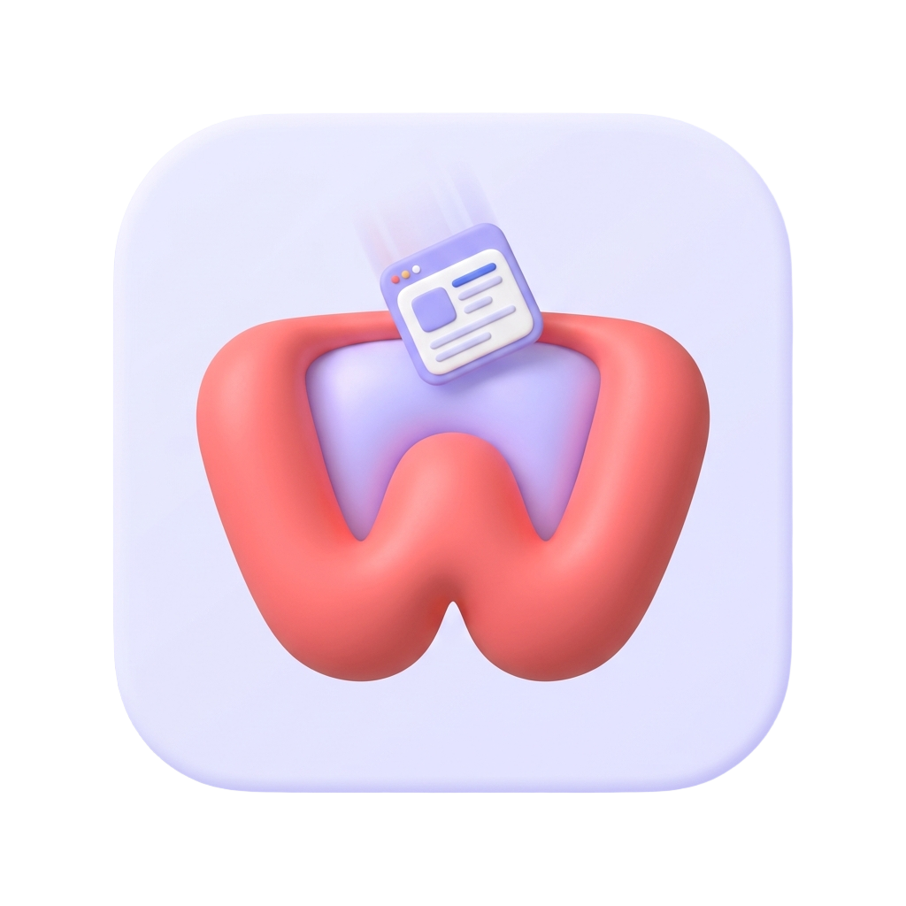

<div align="center">
  
  <h1>Webbin</h1>
  <p>装在浏览器里的私人稍后读与网页收集箱</p>

[](https://workers.cloudflare.com/)
[](https://www.tampermonkey.net/)
[](https://github.com/MuYukk1/webbin)

</div>

## 这是什么工具？

平时上网冲浪经常会遇到这种情况：刷到一篇长文章、或者一个几十分钟的 B 站干货视频，当时没空细看，随手点个收藏，结果进了收藏夹就再也没打开过；又或者过阵子突然想找以前看过的某个观点，却完全想不起来是在哪篇网页或哪个视频里看到的。

**Webbin 就是为了解决这个问题做的小工具。**

它平时只是一个缩在浏览器右下角的 📥 小按钮，不占地方。当你看到想留着的内容时：

1. **点一下就能存起来**：普通网页会自动把排版干净的正文抠出来保存（不怕原网页以后失效或被删）；如果是 B 站视频，可以直接抓取视频的**字幕**和**高赞评论区（含楼中楼）**存成文字，你甚至可以在 UP 主主页按时间段一次性把几十个视频的字幕全抓下来。
2. **手机和电脑互通**：电脑浏览器（Chrome / Edge）和手机（比如安卓 Edge）都能装，两边连的是你自己的同一个云端收集箱，随手存、随时看。
3. **接上 AI 帮读、帮找（可选）**：如果你有 DeepSeek、OpenAI、硅基流动等任意家的 API Key，填进设置里，就能直接让 AI 帮你总结长文/长视频的要点；还能在「对话」里直接提问——比如*“我之前存过的文章里是怎么评价某某技术的？”*，它会自己去翻你存过的资料来回答，并标出出处。哪怕你不填 AI，只把它当成一个纯粹的网页/B站字幕收集器也完全能用。
4. **完全免费、数据在自己手里**：市面上类似的稍后读软件大多要按月收费，东西也存在别人的服务器上。Webbin 借用了 Cloudflare 提供的免费云服务，不需要你买服务器，也不用懂编程，点几下按钮就能在自己的账号下搭一套私人后台，日常使用完全在免费额度内。

---

## 怎么安装和部署？

虽然说是“自己搭后台”，但全程**不用敲代码、也不用买服务器**。

你只需要先准备好两个免费账号：
- 一个 **GitHub 账号**（用来放代码副本）
- 一个 **Cloudflare 账号**（用来免费运行你的私人后台，直接去 [cloudflare.com](https://www.cloudflare.com/) 注册即可，不需要绑信用卡）

准备好后，按下面两步走，大约 5 分钟就能用上。

### 第一步：一键搭建你的私人后台

点击下面这个橙色按钮，会直接跳转到 Cloudflare 的自动部署向导：

[](https://deploy.workers.cloudflare.com/?url=https%3A%2F%2Fgithub.com%2FMuYukk1%2FWebbin)

打开后跟着页面提示走就行，只需要注意这几个地方：

1. **关联 GitHub**：按页面提示登录 Cloudflare 并授权连接你的 GitHub，它会帮你在你自己的 GitHub 下复制一份本项目的代码（名字默认叫 `Webbin`，不用改）。
2. **设置你的专属密码（重要）**：在页面里往下找 **Worker secrets（或密钥）** 这一栏，你会看到一个叫 `TOKEN` 的输入框。
   - 在这里随便填一串**你自己设定的复杂密码**。
   - *说明：这个密码就是你以后进自己收集箱的钥匙，防止别人乱看或乱存你的收集箱。它不是你的账号密码，也不是 AI 的 Key。*
3. **点击部署（Deploy）**：页面里其他的选项（比如 `Build command` 是 `npm run build`、`Deploy command` 是 `npm run deploy`）保持默认不用动，直接点底部的 **Deploy**。
4. **记下你的后台地址**：等它转圈跑完（大概一两分钟），页面上会给你一个类似 `https://webbin.xxxx.workers.dev` 的网址。**把这个网址复制下来**，你的后台就搭好了！

> 💡 如果部署过程中遇到全英文看不懂、或者漏填了 `TOKEN` 导致报错，别慌，照着这篇《[新用户图文排错与详细手册](docs/DEPLOY.md)》一步步核对即可。

---

### 第二步：在浏览器里装插件并连上后台

后台搭好后，我们需要在浏览器里把右下角的 📥 按钮装出来。它是通过浏览器很常用的「篡改猴（Tampermonkey）」扩展来运行的：

1. **先装篡改猴扩展**：去浏览器的扩展商店搜索安装 [Tampermonkey](https://www.tampermonkey.net/)（电脑 Chrome / Edge 商店里都有；安卓手机如果用 Edge 浏览器，也可以直接在扩展里装 Tampermonkey）。
   - *注：装好后如果浏览器提示“需开启开发者模式/运行用户脚本权限”，按篡改猴的提示在扩展管理里把开关打开。*
2. **安装 Webbin 脚本**：
   - 点击浏览器右上角的 Tampermonkey 图标 → 打开「**管理面板**」。
   - 点顶部的「**实用工具**」标签页 → 找到「**从 URL 安装**」输入框。
   - 在里面填上：`你的后台地址/userscript.user.js`
     （比如你第一步拿到的地址是 `https://webbin.abc.workers.dev`，那这里就填 `https://webbin.abc.workers.dev/userscript.user.js`），然后点安装。
3. **填入地址和密码**：
   - 随便打开一个普通网页（注意浏览器自带的新标签页/设置页是不运行脚本的，随便开个百度或 B 站就行），你会看到网页右下角多了一个 **📥 按钮**。
   - 点一下它，切到「**设置**」标签页：
     - **Worker 地址**：填你第一步拿到的那个 `https://webbin.xxxx.workers.dev`（注意结尾不要带 `/userscript.user.js`）
     - **Token**：填你第一步自己设定的那串 `TOKEN` 密码
   - 点「**保存连接信息**」，再点一下「**测试连接**」。只要提示连接成功，大功告成！现在你可以随便点「保存当前页」试试看了。

---

## 日常怎么用？

- **存单篇网页 / 视频**：看到想存的页面，点右下角 📥 → 点「保存当前页」。
- **批量存网页 / 批量抓 B 站 UP 主字幕**：在面板里点「批量」，可以直接粘贴一堆网址进去；如果你当前正打开某个 B 站 UP 主的个人空间，还可以直接选时间范围（比如最近 30 天、最近一年），一键把这位 UP 主这段时间所有视频的字幕全抓进收集箱。
- **配置 AI 总结与对话**：在面板「设置」里，往下拉找到 AI 配置：
  - **API Base**：填你用的 AI 服务商接口地址（比如 DeepSeek 就是 `https://api.deepseek.com/v1`，OpenAI 就是 `https://api.openai.com/v1`）
  - **API Key**：填你在对应平台申请的 Key（Key 会加密保存在你自己的 Cloudflare 后台里，不会泄露到网页前端）
  - 点保存后，点一下「刷新模型列表」，选好你要用的模型再保存，就能在列表里点「总结」，或者去「对话」标签页里向你的收集箱提问了。
- **管理分组**：东西存多了可以建不同的分组（比如“技术文章”、“菜谱”、“待看视频”），在「对话」提问时也可以指定只让 AI 翻某几个分组或某几篇资料。

---

## 进阶玩法与后续更新

### 以后作者更新了新功能，我怎么升级？

不需要重新部署，更不要再去点最上面的橙色部署按钮（重来一遍会新建一个空的收集箱）。

升级只需要两步：
1. 打开**你自己的 GitHub 仓库**（就是第一步自动帮你创建的那个 `Webbin` 仓库） → 点顶部的 **Actions** → 在左边点 **「更新 Webbin」** → 点右边的 **Run workflow**。等它跑完出现绿勾，你的后台就自动同步到最新版了，以前存的数据和设置全都会保留。
2. 油猴脚本平时会自动检查更新；如果想立刻用上新版界面，去 Tampermonkey 管理面板里点一下「检查更新」，或者按安装时的办法重新「从 URL 安装」覆盖一次即可（本地聊天记录和设置不会丢）。

详细说明和老用户迁移办法请看《[部署与更新手册](docs/DEPLOY.md)》。

### 把收集箱自动存回电脑本地（可选）

如果你习惯用 Obsidian、Logseq 等软件在电脑本地管理 Markdown 笔记，可以配合同系列的电脑端小工具 [bili-inbox](../bili-inbox) 一起用。配置好你的后台地址和密码后，双击运行就能把收集箱里新存的网页和 B 站视频字幕自动下载整理成电脑里的 `.md` 文件，并在手机/网页端标记为“已归档”。

---

<details>
<summary><strong>🔧 开发者说明（本地调试与 API 接口文档，普通用户无需查看）</strong></summary>

### 整体架构

```text
手机/电脑浏览器 (Tampermonkey 油猴脚本)
       │
       ▼  保存 / 查看 / 总结 / 对话
Cloudflare Worker (index.js)  ──►  Cloudflare KV (持久化存储条目、分组与加密配置)
       ▲
       │  拉取待归档条目 / 回写归档状态
PC 归档脚本 (bili-inbox，可选)
```

本仓库包含 **Worker 后端**（`index.js`）和**油猴脚本**（`userscript/webbin.user.js`）。

### 本地开发

```bash
npm ci
# 复制 .dev.vars.example 为 .dev.vars，只在 .dev.vars 中填写本地测试用的 TOKEN
npx wrangler dev                  # 启动本地 Worker（使用本地模拟 KV，不影响线上数据）
npm run build                     # 运行完整单元测试套件
```

### HTTP API 列表

除 `/` 与 `/userscript.user.js` 外，所有 `/api/*` 请求均需在 Header 中携带 `x-token: <你的 TOKEN>`：

| 方法 | 路径 | 说明 |
|---|---|---|
| POST | `/api/save` | 保存条目 `{url, title, site, type, content, group_id?}` |
| GET | `/api/items` | 获取条目列表（默认不含正文；传 `?full=1` 返回全量内容） |
| GET/DELETE | `/api/item/:id` | 获取单条详情（含正文） / 删除单条 |
| POST | `/api/summarize` | 调用配置的 LLM 对指定条目生成总结 `{id}` |
| POST | `/api/status` | PC 归档脚本回写归档结果 `{id, status, archive, summary}` |
| GET/POST | `/api/settings` | 读取 / 保存 LLM 配置（GET 对 API Key 做掩码回显） |
| POST | `/api/models` | 通过服务端代理拉取 `{api_base}/models` 模型列表 |
| GET/POST | `/api/groups` | 获取分组列表 / 增删改分组（`{action: create\|rename\|delete, id?, name?}`） |
| POST | `/api/group/assign` | 批量移动条目到指定分组 `{ids[≤200], group_id}` |
| GET | `/api/kb/metadata` | 分页读取知识库元数据 `?cursor=&limit=`（单页 ≤40，不含正文） |
| POST | `/api/chat` | 知识库对话代理接口，转发至上游 OpenAI 兼容 `/chat/completions` |

</details>
